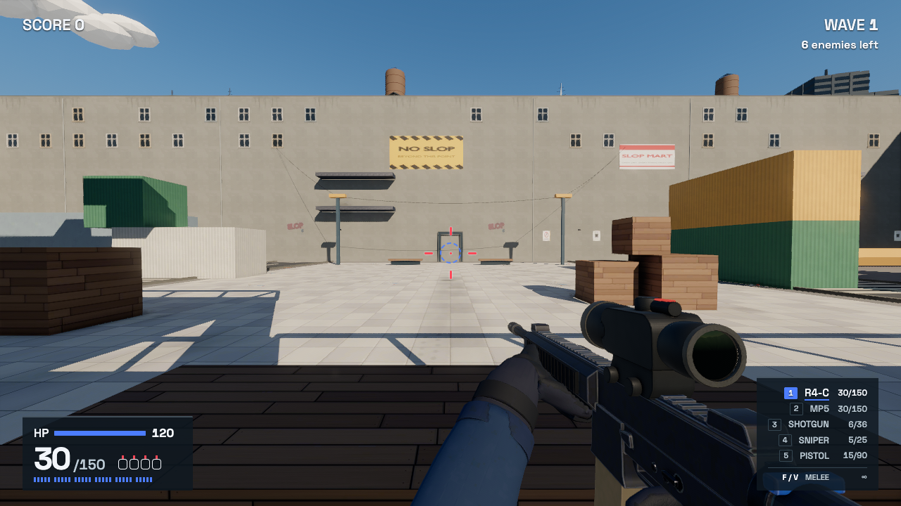
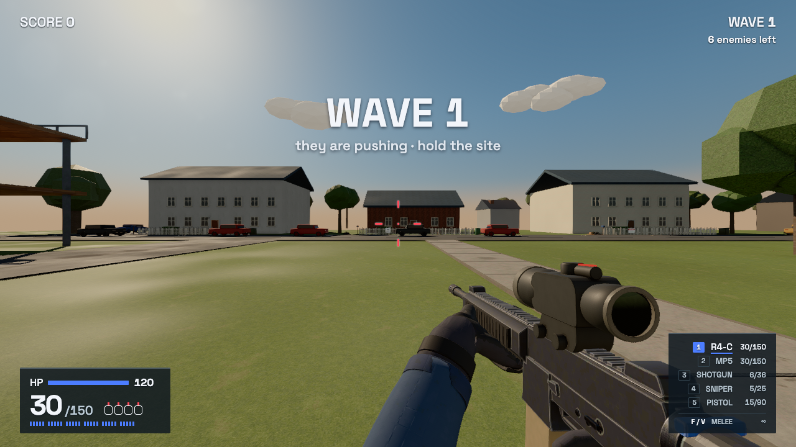
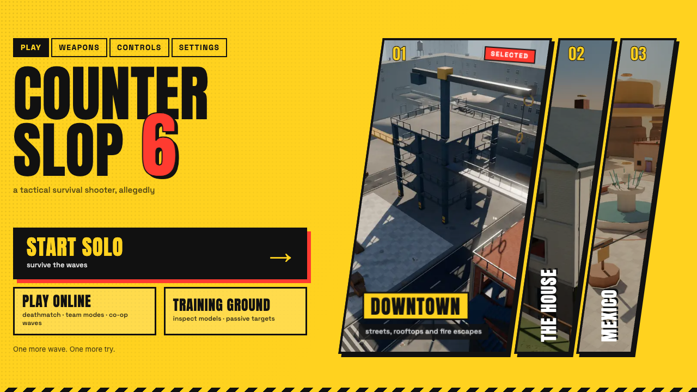

# Counter Slop 6

A tactical survival shooter, allegedly. Runs in the browser, no install.

**Play:** https://counter-slop-6.vercel.app







## What it is

- Solo wave survival, online co-op survival for up to 4 players, or online deathmatch and team modes for up to 8 (peer-to-peer, no server).
- Three maps: **Downtown** (streets, rooftops, fire escapes), **The House** (a suburban home, basement to rooftop) and **Mexico** (a sun-baked plaza), plus a training ground.
- R4-C, MP5, shotgun, sniper, pistol, LMG, combat knife. Grenades. Grapple, slide, wall jump, double jump, air dash.
- Enemies lead their shots, take cover between bursts, fan out and dodge grenades.
- Mouse + keyboard or controller.
- Graphics presets (Settings → Graphics, auto-picked for your device): Low keeps the flat low-poly look for phones; Medium, High and Ultra go realistic (self-made Blender textures, baked light, haze, light shafts on Ultra), each setting adjustable under Advanced.

## Controls

| Action | Keyboard / mouse | Controller |
| --- | --- | --- |
| Move / look / sprint | WASD / mouse / Shift | L stick / R stick / L3 |
| Fire / aim | LMB / RMB | R2 / L2 |
| Jump, wall jump, double jump | Space | ✕ / A |
| Slide / air dash | C or Ctrl | ○ / B |
| Grapple | Q or E | L1 / LB |
| Katana slash | F | R1 / RB |
| Grenade (hold to throw further) | G | R3 or d-pad up |
| Reload / weapons | R / 1-6 or wheel | □ / △ |
| Scoreboard / pause | Tab / Esc | View / Menu |

## Run it locally

```sh
npm install
npm run dev        # http://localhost:3000
```

```sh
npm run typecheck && npm test   # tsc + vitest
npm run build                   # static export to out/
npm run smoke                   # boots the engine in headless Chromium against a running dev server
```

Next.js, React, TypeScript, three.js, PeerJS. Design docs in [`docs/`](docs/ARCHITECTURE.md).

## How it is built: with coding agents

Nearly all of the code, docs, tests and asset scripts here were written by AI coding agents (mostly Claude). One developer directs them: picks what to build, plays it, compares it with references and says what is wrong. The repo is set up so that agents can change it safely.

- **Specs first.** Before any code, agents wrote a prose spec for each system ([`docs/spec/`](docs/spec): movement and physics, weapons, enemies, networking, HUD and more) and an integration contract ([`docs/ARCHITECTURE.md`](docs/ARCHITECTURE.md)) that fixes each module's public surface. So several agents could build modules in parallel and have them link on the first try. The specs stay normative: a change in behaviour updates its spec in the same commit.
- **Clean room.** The first version rebuilt the gameplay of a reference browser game. Spec writers studied it; implementers saw only the specs. No code or asset from it is in this repo.
- **Implement, then review.** Large features run as multi-agent workflows: agents implement from the specs, then a reviewing agent checks the result against the spec and redoes what was missed.
- **Guardrails.** Strict TypeScript, 37 vitest files that run in a real browser, and 26 Playwright scripts that drive the game: two browsers playing co-op over real WebRTC, a check that each optic's overlay matches its 3D model, screenshot sets for visual review, and frame-time budgets on the real GPU.
- **Assets as code.** Nothing is downloaded. Blender scripts in [`tools/`](tools) build the textures, guns, characters, props, effects, skies and light bakes headless, so an agent can change an asset the way it changes code.
- **One feature, one PR.** Each feature is a branch and a PR with its checks and a Vercel preview, then a merge to `main`, which deploys. About 125 commits and 21 PRs from 11 September to 16 October 2026.
- **Instructions for agents** are in [`AGENTS.md`](AGENTS.md) (`CLAUDE.md` points to it): the rules, where the source of truth is, and which checks to run.
